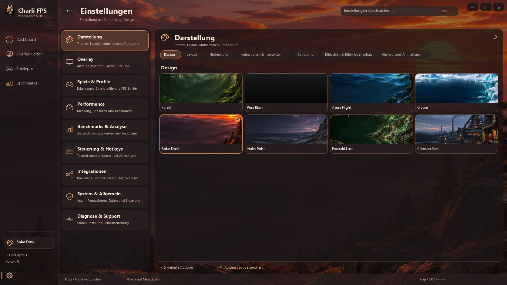
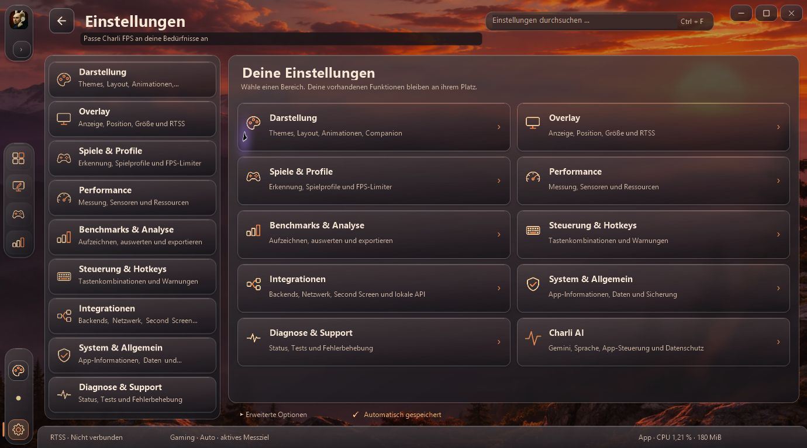
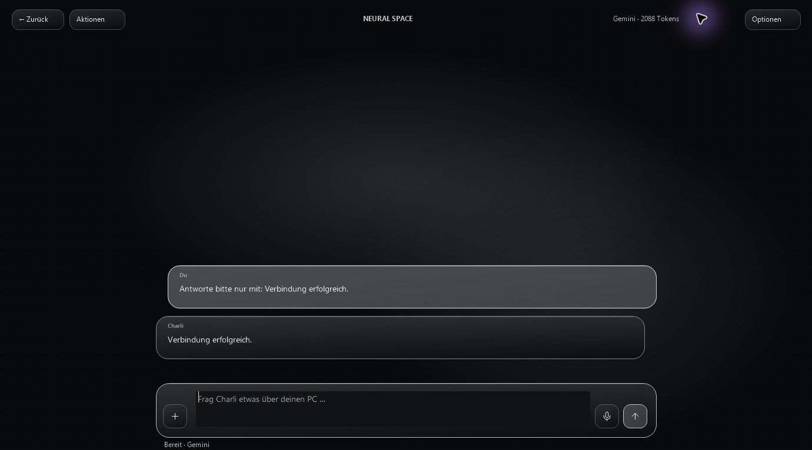
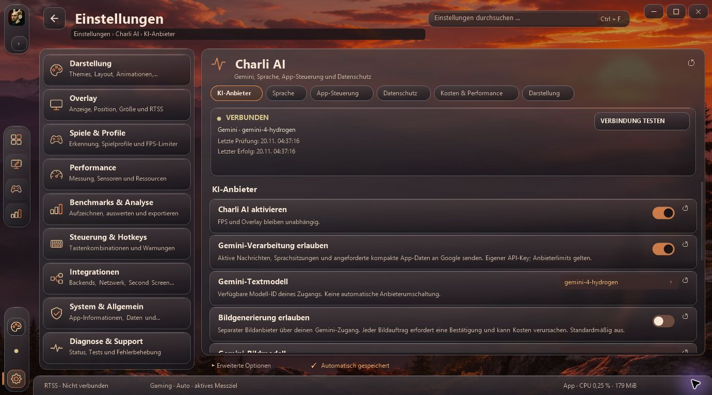

# Charli FPS — For Low Performance Usage

Eine Windows-App für FPS- und Frametime-Messungen, kompakte Gaming-Overlays und nachvollziehbare Benchmarks – mit einstellbarer Oberfläche und acht animierten Themes.

**[Aktuelle Version herunterladen](https://github.com/yousefayat732-prog/charli-fps-releases/releases/latest)** · **[Alle Veröffentlichungen](https://github.com/yousefayat732-prog/charli-fps-releases/releases)**

Dieses öffentliche Repository enthält Installationspakete, den Update-Kanal und Vorschaubilder. Der Quellcode bleibt privat.

## Ein Blick in Charli FPS

Die Vorschau zeigt die echte Windows-Oberfläche ohne laufende Spielmessung. Fehlende Messwerte erscheinen ausdrücklich als nicht verfügbar.

Forest, Pure Black, Azure Night, Glacier, Solar Dusk, Violet Pulse, Emerald Luxe und Crimson Steel sind direkt in der App auswählbar.

## Was die App bietet

- Externe FPS- und Frametime-Erfassung über PresentMon/ETW, mit klar erkennbarer Messquelle und Verfügbarkeit.
- Anpassbare Overlays mit Position, Größe, Farben und auswählbaren Messwerten; Spielprofile, Benchmark-Auswertung und Exporte.
- Vollständige Einstellungsseite mit Suche, Kategorien und passenden Untergruppen.
- Ein gemeinsamer Player für acht lokale MP4-Hintergründe. Nur das aktive Theme wird geladen; Hardwaredecodierung wird genutzt, wenn Windows und Treiber sie unterstützen. Minimieren und aktivierte Spiel-Pausierung reduzieren die Hintergrundarbeit. Reduced Motion verwendet das Originalbild.
- Einstellbare Hover- und Klickübergänge sowie Eco-, Balanced- und Premium-Profile für die Oberfläche. Die visuelle Glättung verändert keine gemessenen FPS.

## Liquid Glass und Charli AI

Die vorhandene Navigation, acht Original-Themes und sämtliche Messfunktionen bleiben erhalten. Eigene statische Bild-Themes lassen sich zusätzlich speichern, aktivieren, umbenennen, farblich anpassen, exportieren und nach Bestätigung löschen.

Charli AI nutzt deinen eigenen Gemini-Zugang. Stop bricht laufende Aufträge ab; Fehler erhalten Entwürfe und empfangene Teilantworten. PNG-, JPEG- und WEBP-Anhänge werden lokal vorgemerkt und erst bewusst mit einer Nachricht gesendet. WEBP benötigt einen passenden Windows-Codec. Bilder bleiben standardmäßig im Sitzungsspeicher.

Ein gespeicherter Schlüssel allein erzeugt keinen verbundenen Status. Modell und Erfolgszeit beruhen auf einer tatsächlichen Antwort. Schlüssel werden für das Windows-Benutzerkonto verschlüsselt gespeichert.

Bildgenerierung verwendet ein getrennt ausgewähltes Bildmodell, ist standardmäßig aus und verlangt vor jedem Auftrag eine Bestätigung. Modellzugriff, Kontingent, Antwortzeit und Kosten hängen vom Anbieter ab. Es gibt keinen automatischen Modellwechsel und keine automatischen Bild-Neuversuche.

## Installation und Updates

1. Das aktuelle **Setup-x64.exe** unter [Releases](https://github.com/yousefayat732-prog/charli-fps-releases/releases/latest) herunterladen und ausführen.
2. Den Einrichtungsassistenten durchgehen. Die externe Messhilfe kann eine Windows-Berechtigungsabfrage benötigen.
3. Spätere Updates stehen unter **Einstellungen → System & Allgemein → Updates → Nach Updates suchen** bereit. Bei einer neueren Version erscheint rechts **Installieren**. Andernfalls erscheint der rote Hinweis **Kein neues Update verfügbar**; Verbindungsfehler werden gesondert angezeigt.

Bestehende Einstellungen und Profile bleiben bei normalen Updates erhalten. Eine Deinstallation mit ausdrücklich gewählter Datenlöschung ist davon ausgenommen. Sehr alte Versionen ohne Update-Funktion benötigen einmalig das aktuelle Setup.

## Voraussetzungen und Spielkompatibilität

Windows 10 oder 11, **64 Bit**. Nicht verfügbare Sensoren werden nicht durch Beispielwerte ersetzt. Videohintergründe sind optional; bei fehlender Medienunterstützung oder einem Ladefehler bleibt das Originalbild erhalten.

Ein externes Overlay ist nicht in jedem Spiel und exklusiven Vollbildmodus sichtbar. Für VALORANT/Vanguard gelten die vorhandenen Schutzregeln: keine Umgehung und keine erzwungenen Hooks. Je nach Spiel ist die Anzeige im Dashboard auf einem zweiten Monitor die geeignete Alternative. Eine allgemeine Anti-Cheat-Freigabe wird nicht behauptet.

## Transparente Veröffentlichung

Update-Dateien werden mit **Ed25519** signiert und zusätzlich mit einer SHA-256-Prüfsumme veröffentlicht. Diese Update-Signatur ist kein Windows-Authenticode-Herausgeberzertifikat. Es werden keine Benutzerkonfigurationen, privaten Protokolle oder Signierschlüssel veröffentlicht.

Für 0.25.0 bestanden lokal 188 kontrollierte KI-Prüfungen, native Einstellungs-/Bild-/Theme-Tests und ein Hardware-Lauf mit 32 Original-Theme-Wechseln plus vier eigenen Standbild-/Originalwechseln. Eine echte Hydrogen-Textantwort wurde im installierten Chat geprüft. Der unabhängige Windows-Build bestand 19 Tests; vier Desktop-/GPU-Tests wurden auf dem GitHub-Runner übersprungen und stattdessen lokal geprüft.

Reale Bildgenerierung und physische Mikrofon-/Hörabnahme wurden nicht automatisch freigeschaltet oder als bestanden ausgegeben. Ein zusätzlicher Bildverständnis-Aufruf erhielt zuletzt einen Anbieterfehler 503. Format- und Modellunterstützung garantieren keine momentane Verfügbarkeit beim Anbieter. Auch physisch sichtbare 180 Bilder/s oder die Sichtbarkeit in jedem Spiel werden nicht pauschal zugesichert. Einzelheiten stehen in den jeweiligen Release-Hinweisen.